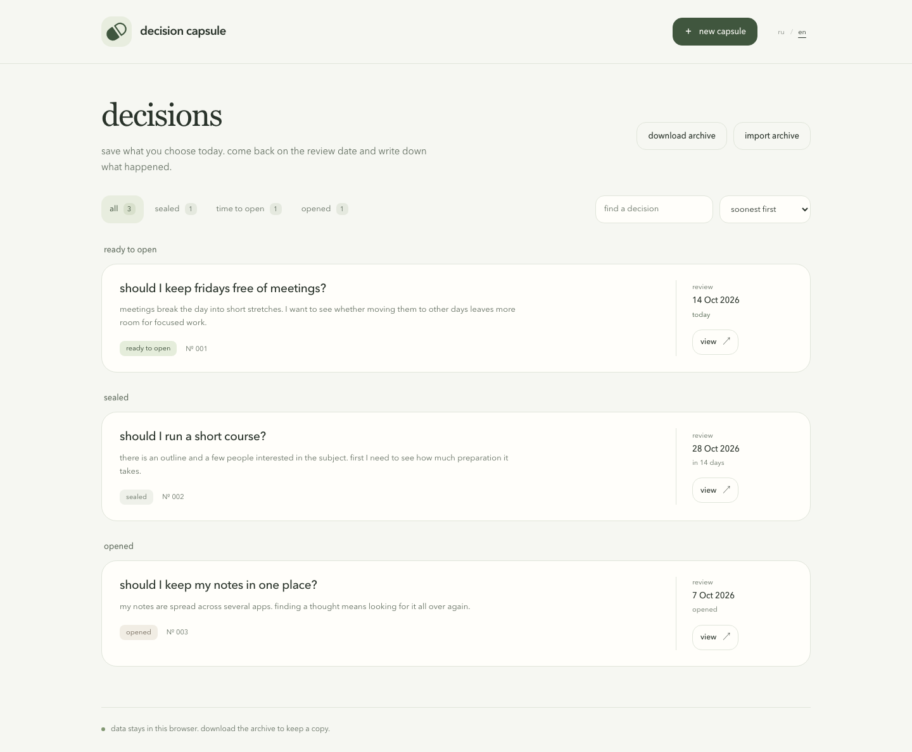
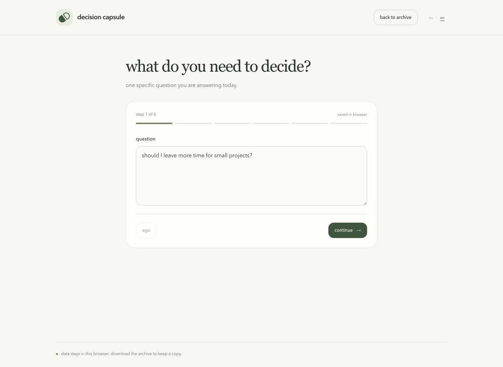
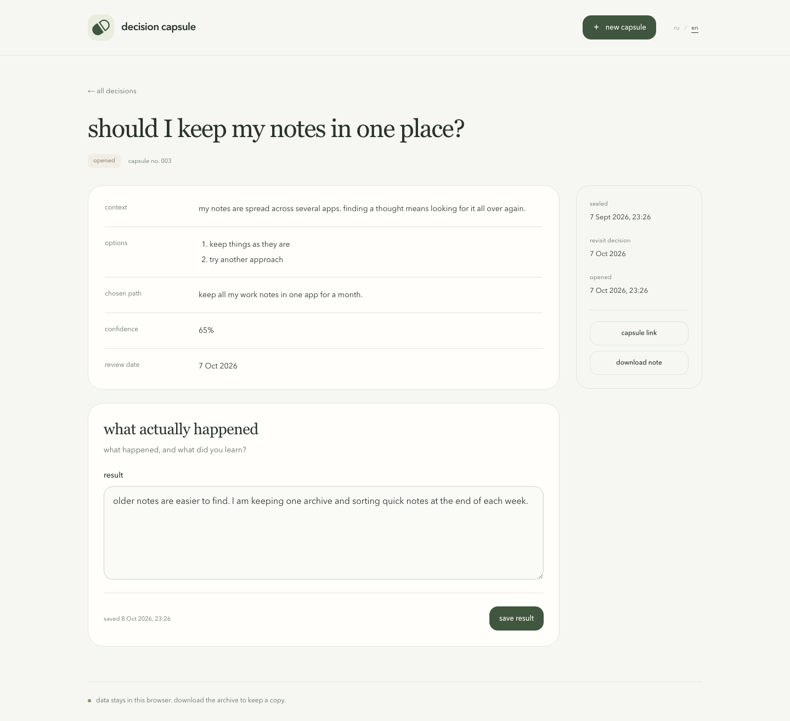
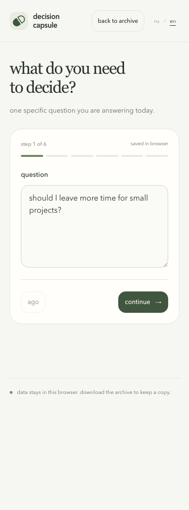

**english** · [русский](README.ru.md)

# decision capsule

save a decision with its context, then come back on a chosen day to record what happened.

[open the app](https://chebaturkin.github.io/decision-capsule/?lang=en)

a capsule keeps your question, options, chosen path, confidence and review date. when that date arrives, open it manually and add a result. the original decision stays unchanged.

## a look inside

the archive has search, filters and sorting. these screenshots use demonstration entries.



<details>
<summary>create a capsule</summary>



</details>

<details>
<summary>the decision and its result</summary>



</details>

<details>
<summary>on a phone</summary>



</details>

## make your first capsule

1. write the question and the context you want to remember.
2. add at least two options, record your choice and set your confidence.
3. choose a review date, check the summary and seal the capsule.
4. return on or after that date, open the capsule and add what happened.

you can leave an unfinished capsule and resume its draft later. after sealing, the original question, context and choice stay fixed so you can compare them with the result.

## where the data stays

capsules are saved in indexeddb in this browser. there is no account, server database or analytics. clearing browser data can remove the archive. download a json backup before changing browsers or clearing storage.

review dates follow your device calendar and time zone. the app does not send reminders. you need to return and open a capsule yourself.

## move your entries

- **download archive** saves every capsule in a json file.
- **import archive** checks the file, counts new and duplicate capsules, then adds new entries after confirmation.
- **download note** saves one capsule as markdown, with labels in the current interface language.
- **capsule link** carries one entry in a link.

link data is not encrypted. anyone with the link can read the capsule. sealing preserves the original entry inside the app; it is not a password or a way to hide a file from someone using your device.

## language

use **ru / en** in the header. a valid `?lang=ru` or `?lang=en` link takes priority, followed by your saved choice, the first supported browser language and english as the fallback. switching keeps your current step, unsaved text, archive and other url parameters. your own writing is never translated.

## run locally

```sh
npm ci
npm run dev
```

open the local app in [english](http://127.0.0.1:5173/?lang=en) or [russian](http://127.0.0.1:5173/?lang=ru). the app uses html, css and javascript without a framework. its fonts and logo make no external requests.

## checks and build

```sh
npm test
npm run build
```

the build writes static files to `dist` for github pages. it does not read user data.

with a local server running, python, playwright and chromium installed:

```sh
python3 tests/ui_smoke.py
I18N_URL=http://127.0.0.1:5173 python3 tests/i18n_browser.py
```

the checks use an isolated temporary browser. they cover creation, draft recovery, opening, results, search, filters, sorting, import, export, dialog focus, language switching and mobile widths. they do not use your saved data.

to refresh the russian demonstration screenshots:

```sh
python3 tests/ui_smoke.py --screenshots
```
