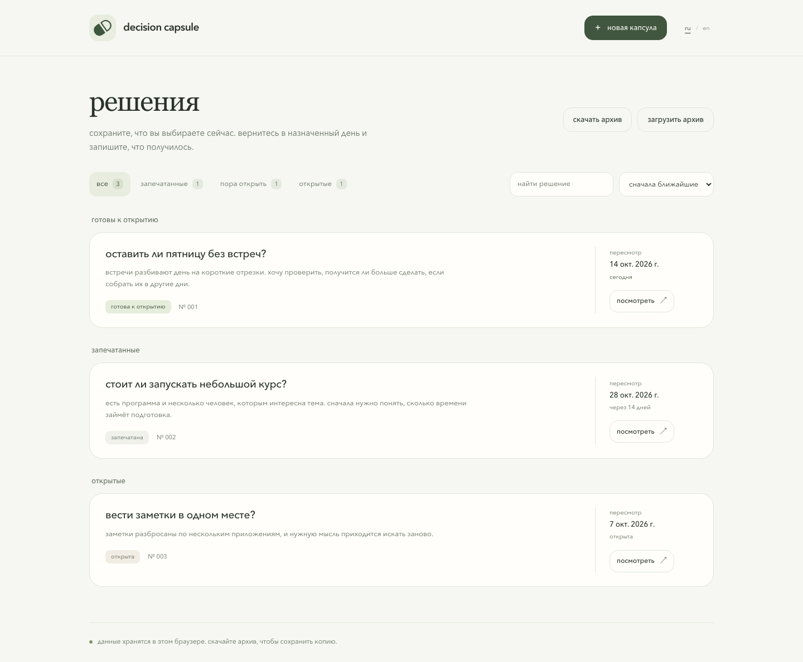
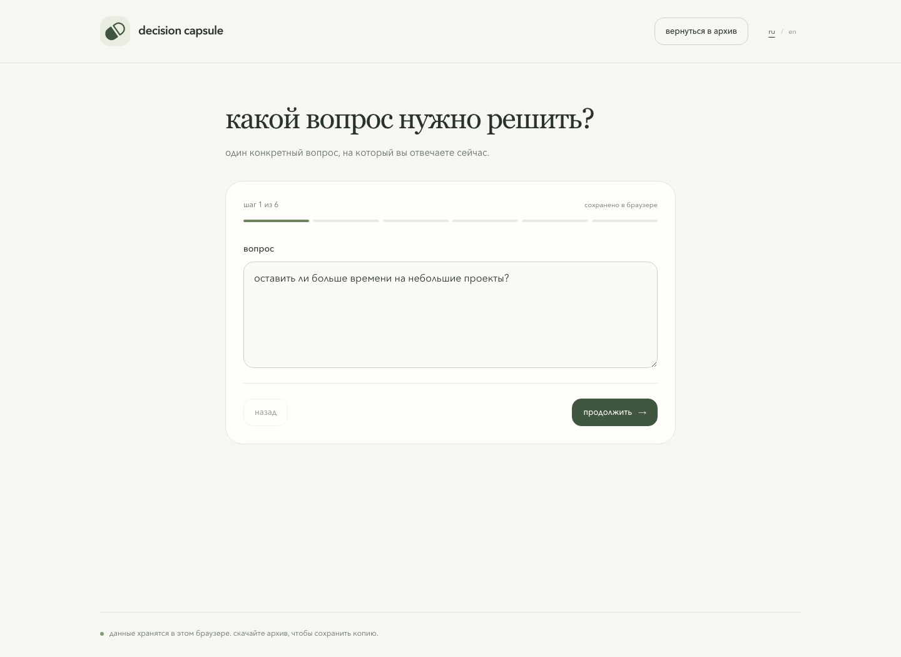
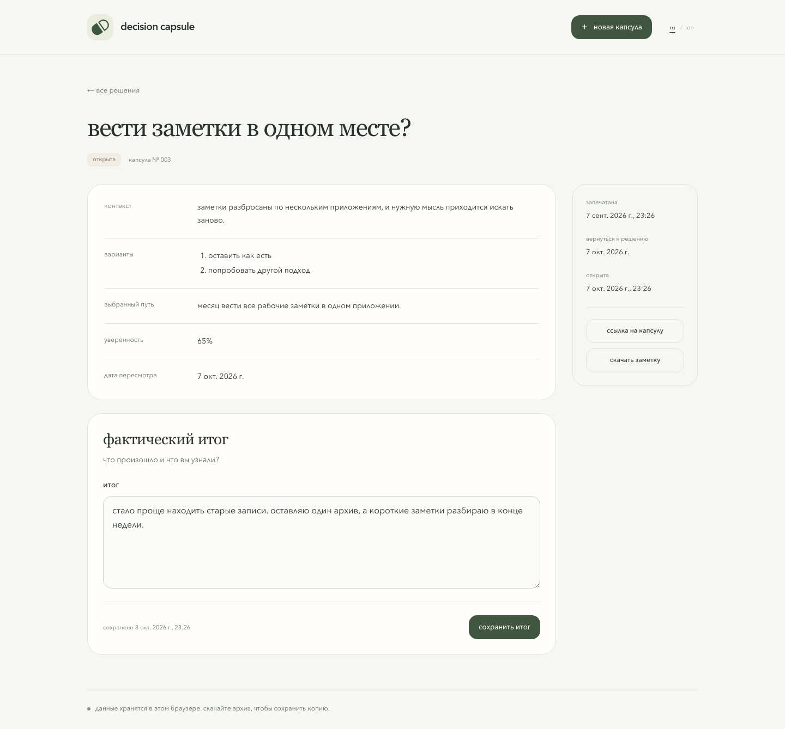
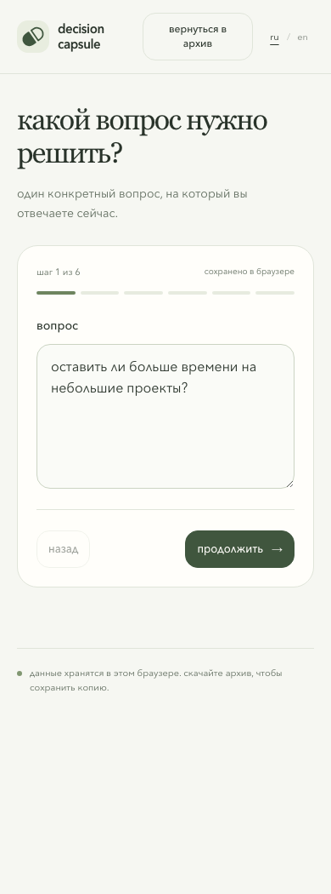

[english](README.md) · **русский**

# decision capsule

сохраните решение вместе с контекстом и вернитесь к нему в назначенный день, чтобы записать, что получилось.

[открыть приложение](https://chebaturkin.github.io/decision-capsule/?lang=ru)

капсула хранит вопрос, варианты, выбранный путь, уверенность и дату пересмотра. когда дата наступит, её можно открыть вручную и добавить итог. исходное решение остаётся неизменным.

## как выглядит

архив с поиском и фильтрами. на скриншотах показаны демонстрационные записи.



<details>
<summary>создание капсулы</summary>



</details>

<details>
<summary>решение и фактический итог</summary>



</details>

<details>
<summary>на телефоне</summary>



</details>

## где хранятся данные

капсулы сохраняются в indexeddb, локальном хранилище этого браузера. аккаунта, серверной базы и аналитики нет. чтобы сохранить копию или перенести записи в другой браузер, скачайте архив.

дата пересмотра считается по календарю и часовому поясу устройства. приложение не отправляет напоминания: открыть капсулу нужно самостоятельно.

## перенос записей

- **скачать архив**: сохранить все капсулы в json-файл;
- **загрузить архив**: проверить файл, показать новые и повторяющиеся капсулы, затем добавить новые после подтверждения;
- **скачать заметку**: сохранить одну капсулу в markdown;
- **ссылка на капсулу**: перенести одну запись через ссылку.

данные в ссылке не зашифрованы. любой, у кого она есть, сможет прочитать капсулу.

## локальный запуск

```bash
npm install
npm run dev
```

откройте `http://127.0.0.1:5173`.

приложение написано на html, css и javascript, без фреймворка. шрифты и логотип не требуют внешних запросов.

## проверка и сборка

```bash
npm test
npm run build
```

сборка создаёт статические файлы в `dist` для github pages. пользовательские данные при этом не читаются.

при запущенном локальном сервере можно пройти сценарии в браузере. для этой проверки нужны python и playwright с установленным chromium:

```bash
python3 tests/ui_smoke.py
```

проверка создаёт записи в отдельном временном браузере: создание, сохранение черновика, открытие, итог, поиск, фильтры, импорт и экспорт. также проверяет фокус в диалогах и ширину страниц на телефоне. ваши данные она не использует.

чтобы обновить демонстрационные скриншоты:

```bash
python3 tests/ui_smoke.py --screenshots
```

## язык

ru / en в шапке меняет язык без перезагрузки. явный `?lang=ru` или `?lang=en` важнее сохранённого выбора, затем учитывается первый поддерживаемый язык браузера. по умолчанию используется английский. черновик, несохранённый итог, архив и параметры ссылки остаются на месте. ваши записи не переводятся.
